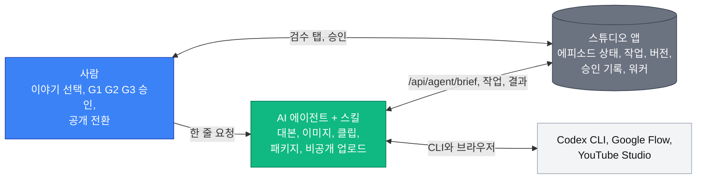
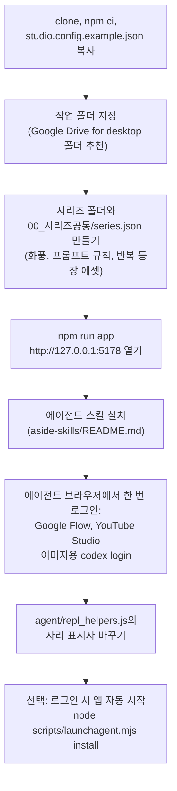
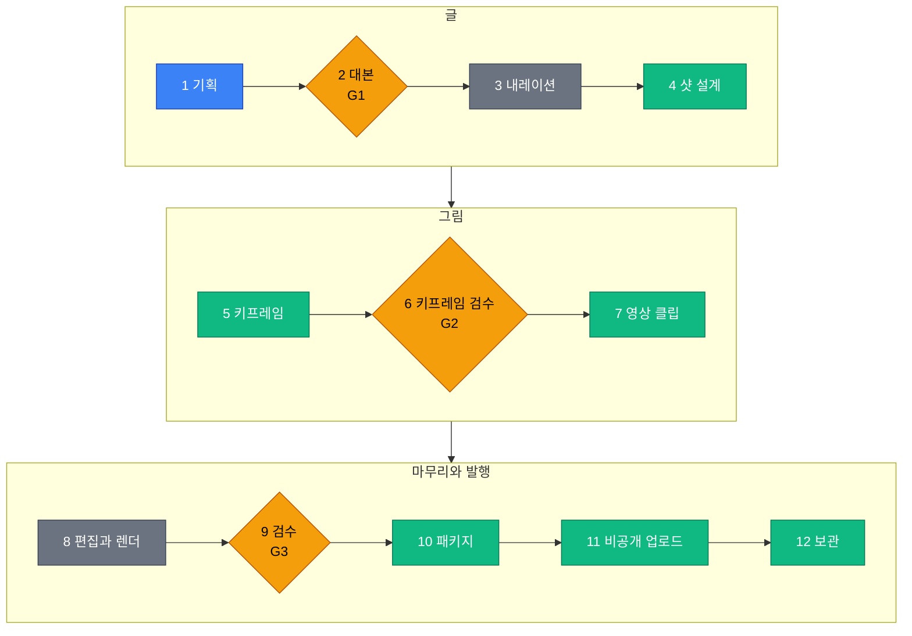
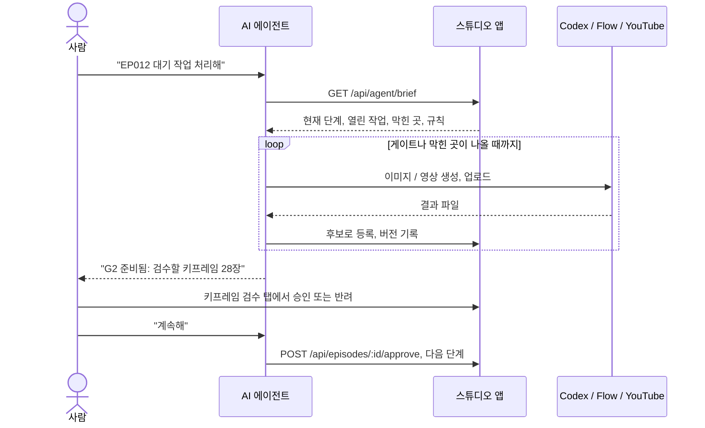
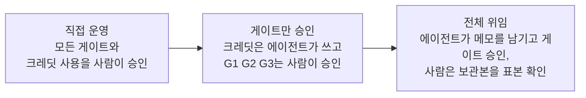
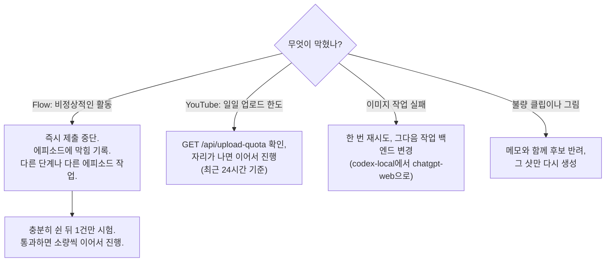
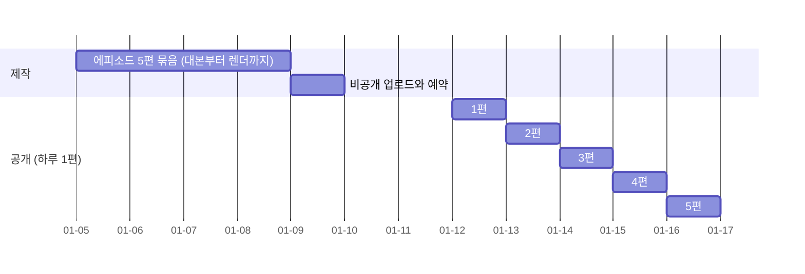

# Long Memory Studio

[English](README.md) | **한국어**

내레이션이 들어간 롱폼 AI 다큐멘터리를 만드는 로컬 제작 스튜디오입니다(YouTube 시리즈 "The Bible in Order"를 만들면서 개발).
에피소드마다 대본, 내레이션, 샷 계획, 키프레임, 영상 클립, 렌더, 기술 검사(QC), 패키지, 업로드, 보관 상태를 로컬 웹 앱에서 관리하고,
[Remotion](https://www.remotion.dev/)으로 렌더하며, AI 에이전트가 직접 다룰 수 있는 API를 제공합니다.

평소 작업 방법은 [사용 방법: 작업 흐름](#사용-방법-작업-흐름)을 먼저 보세요.

개인 프로젝트를 그대로 공유한 것입니다. 경로, 프롬프트, 12단계 작업 흐름은 한 채널에 맞춰져 있으니 자기 상황에 맞게 고쳐 쓰는 것을 전제로 합니다.

## 준비물
- macOS (내레이션은 macOS 기본 `say` 음성을 쓰고, Google Drive 캐시 정리에 `swift`를 씁니다)
- Node.js 20 이상과 npm
- 쓰는 단계에 따라 선택: Codex CLI(이미지 생성, 번역 스크립트), 작업 폴더로 쓸 Google Drive for desktop 폴더,
  브라우저 에이전트가 조작할 Google Flow / YouTube Studio 계정(`agent/` 헬퍼)

## 빠른 시작
```
npm ci
xattr -dr com.apple.quarantine node_modules      # macOS가 포함된 실행 파일을 막을 때만
cp studio.config.example.json studio.config.json # "workspace"에 에피소드를 둘 폴더 경로를 적기
npm run app                                      # http://127.0.0.1:5178
```
작업 폴더 아래에 시리즈 폴더를 만들고(설정의 `series` 참고), 에피소드는
`node scripts/new-episode.mjs <ID> --series <sid> --ep <N> --title "<제목>"`으로 등록합니다.
`agent/repl_helpers.js`의 브라우저 헬퍼에는 바꿔 넣어야 할 자리 표시자(`YOUR_FLOW_PROJECT_ID`, `YOUR_CHANNEL_ID`, `/Users/YOU`)가 있습니다.

## 사용 방법: 작업 흐름

Long Memory Studio는 **사람 + AI 에이전트** 조합으로 쓰도록 만들었습니다. 사람은 창작 판단을 하고 세 번의 승인 게이트를 통과시키며,
AI 에이전트(여기서는 [Aside](https://asidehq.com)와 `aside-skills/`의 스킬)가 반복 작업을 맡습니다.
모든 결과는 앱에 남기 때문에 특정 대화 세션에 의존하지 않습니다.



### 1. 처음 한 번 하는 설정



시리즈 설정 파일에서 채널의 그림체를 한 번 정합니다(화풍, 화면에 절대 나오면 안 되는 것, 반복 등장하는 인물과 장소).
모든 이미지와 영상 프롬프트가 이 파일을 바탕으로 만들어지므로 1화를 만들기 전에 충분히 다듬는 것이 좋습니다.

### 2. 에피소드 하나, 12단계

모든 에피소드는 같은 12단계를 거칩니다. 앱이 단계마다 완료 여부를 스스로 확인하고(파일 존재, 버전 채택, 승인 기록)
에피소드 홈 탭에 지금 어디까지 왔는지 보여 줍니다.



G2에서 반려한 그림은 그 샷만 5단계로 돌아갑니다. G3에서 찾은 문제는 7단계로 돌아가(새 클립 또는 같은 클립의 다른 구간)
해당 파트만 다시 렌더합니다.

파랑: 사람. 주황: 사람의 승인 게이트. 초록: 에이전트. 회색: 앱의 워커(AI 불필요).

| 단계 | 하는 일 | 확인하는 곳 |
|-|-|-|
| 1 기획 | 에피소드의 원전이나 이야기를 고름 | 개인 메모 |
| 2 대본 (G1) | 에이전트가 내레이션과 장면 초안 작성. 약 8분(약 1,150단어)을 넘으면 줄이지 않고 파트로 나눔 | 대본·내레이션 탭 |
| 3 내레이션 | 워커가 macOS 음성으로 대본을 읽음(`scripts/tts.mjs`) | 에피소드 홈 |
| 4 샷 설계 | 에이전트가 장면을 샷으로 나눔: 정지 이미지 또는 영상, 프롬프트, 카메라 | 샷 보드 탭 |
| 5 키프레임 | 이미지 작업(`scripts/kf-jobs.mjs`, Codex CLI)이 후보를 만듦. 채택 전에는 쓰지 않음 | 작업 큐 탭 |
| 6 검수 (G2) | 모든 그림을 시리즈 규칙과 대조. 반려하면 5단계로 돌아감 | 키프레임 검수 탭 |
| 7 영상 | 에이전트가 Flow 작업을 한 건씩 제출, 수집, 등록하고 좋은 클립을 채택 | 작업 큐, 샷 보드 |
| 8 편집 | 스크립트가 매니페스트, 음악 큐, Remotion 렌더를 만듦 | 에피소드 홈 |
| 9 검수 (G3) | 렌더 전체를 시청. 기술 검사(음량, 검은 화면, 해상도)는 자동 | 렌더 검수 탭 |
| 10 패키지 | 제목, 설명, 챕터, 태그, 번역 자막, 썸네일 | 패키지·업로드 탭 |
| 11 업로드 | 비공개 업로드, 자막, 공개 예약 | 패키지·업로드 탭 |
| 12 보관 | 360p 프록시와 정지 이미지 보관, 무거운 로컬 캐시 정리 | 보관 탭 |

### 3. 평소 작업 세션

단계를 하나씩 직접 돌리지 않습니다. 에이전트를 시작하면 앱의 브리프를 읽고, 허용된 일을 모두 한 뒤,
사람의 판단이 필요한 곳에서 멈춥니다.



좋은 습관:
- **에이전트 세션 하나에 에피소드 하나.** 다음 에피소드는 새 세션에서 시작합니다. 앱과 스킬이 상태를 이어 주므로 대화 기록은 필요 없습니다.
- **명령보다 결과로 요청하기.** "EP013 G2까지 만들어", "끝난 파트 올리고 예약해", "막힌 거 뭐야?" 정도면 충분합니다.
- **검수는 대화창이 아니라 앱에서.** 검수 시트와 게이트 탭에서 후보마다 프롬프트와 이력을 나란히 볼 수 있습니다.

### 4. 게이트마다 확인할 것

| 게이트 | 확인할 것 | 흔한 수정 |
|-|-|-|
| G1 대본 | 사실과 출처, 어조, 속도, 파트 분할 | 특정 장면만 다시 쓰게 함. 대본 전체를 줄이게 하지는 않음 |
| G2 키프레임 | 시리즈 규칙(화풍, 금지 내용, 이미지 속 글자 없음), 반복 등장 에셋의 일관성 | 메모와 함께 반려하면 그 그림만 다시 생성 |
| G3 렌더 | 처음부터 끝까지 시청, 음악 음량, 클립의 이상한 부분, 자막 타이밍 | 클립 구간 교체, 해당 파트만 다시 렌더 |

### 5. 어디까지 맡길지 정하기



어느 수준을 고르든 결제, 영상 공개 전환, 참여 조작으로 보일 수 있는 일은 사람이 맡습니다.
앱은 게이트마다 누가 승인했는지 기록하므로(`{"by": "user" | "aside", "note": ...}`) 위임한 결정도 나중에 추적할 수 있습니다.

### 6. 작업이 막혔을 때



플랫폼의 자동화 검사를 우회하려 하지 마세요. 제출 간격과 막힘 기록은 에이전트가 재시도 대신 기다리도록 하기 위한 장치입니다.

### 7. 공개 리듬

제작은 몰아서 해도 공개는 일정하게 합니다. 완성한 에피소드는 비공개로 올리고(우리 계정 기준 최근 24시간에 최대 10편),
에피소드 순서대로 하루 1편씩 공개 예약합니다.



## 에이전트 스킬
`aside-skills/`에는 이 앱을 운영하는 Aside 에이전트 스킬 4개(전체 지휘, Google Flow 영상, 이미지, 댓글 응대)가 들어 있고, 개인 정보는 자리 표시자로 바꿔 두었습니다.
구조와 설치 방법은 `aside-skills/README.md`를 보세요.

## 참고
- Remotion은 별도 라이선스를 씁니다. 개인과 소규모 회사는 무료이고, 그 외에는 회사 라이선스가 필요합니다
  (https://www.remotion.dev/license 참고). 이 저장소의 MIT 라이선스는 여기서 작성한 코드에만 적용됩니다.
- Google Flow와 YouTube Studio에는 이 단계들을 위한 공개 API가 없어서 헬퍼가 웹 화면을 조작합니다. 각 서비스의 이용약관을 따르고,
  사람과 비슷한 속도를 유지하며, 자동화 검사를 우회하지 마세요.
- AI로 만든 미디어는 공개할 때 AI 생성물임을 표시하세요.

## 라이선스
MIT, LICENSE 파일 참고.

## 기술 메모

### 구조
- 코드는 이 저장소(git)에 있고, 미디어와 에피소드 데이터는 **작업 폴더(WORKSPACE)**, 예를 들어 Google Drive 스트리밍 폴더에 있습니다
  (`studio.config.json`의 `workspace`). 무거운 미디어는 커밋하지 않습니다.
- 에피소드 폴더(작업 폴더 안): `episode.json`, `thumbnail.json`, `_app/`, `1_발행본/`, `2_소스/`, `3_폐기_이전본/`, `4_프로젝트백업/`.
- `2_소스/`는 Remotion의 public 폴더입니다: `keyframes/*.jpg`, `clips/*.mp4`, `narration/*.wav`, `bgm/*.wav`, `thumb/`.
  이전 버전은 `keyframes/png`, `keyframes/end`, `keyframes/fix_*`, `clips/_raw`에 남습니다.

### 명령
```
node scripts/tts.mjs <ID> [--force]          # macOS say → 2_소스/narration
node scripts/build-manifest.mjs <ID>         # episode.json + WAV 길이 → src/episodes/<ID>.manifest.json
node scripts/render.mjs <ID> preview|final|thumb [--publish]
                                             # 기본 out/<ID>/, --publish는 1_발행본에 쓰고 이전 파일은 보관
```
새 에피소드는 `scripts/new-episode.mjs`가 `studio.config.json`의 `episodes`와 `src/episodes/registry.ts`에 함께 등록합니다.

### 앱
```
npm run app                                  # UI 빌드 + http://127.0.0.1:5178 시작 (서버 = 워커)
node scripts/launchagent.mjs install         # 선택: 로그인 시 서버 자동 시작 (macOS LaunchAgent)
```
탭: 대장 · 에피소드 홈 · 시리즈 · 대본·내레이션 · 샷 보드 · 키프레임 검수 (G2) · 작업 큐 · 렌더 검수 (G3) · 패키지·업로드 · 보관

| 영역 | 데이터 | 설명 |
|-|-|-|
| 단계 엔진 | 계산 | 완료 조건이 있는 12단계(`GET /api/episodes/:id/stages`), 게이트 G1~G3 |
| 시리즈 | `<series>/00_시리즈공통/series.json` | 화풍, 규칙(프롬프트 조각), 에셋(인물/장소/소품, 범위, 잠금, 에피소드 태그 `usedIn`, 자유 `tags`, 참고 이미지 버전) |
| 샷 | `episode.json` + `_app/production.json` | 버전(키프레임/클립: 채택, 후보, 대체됨, 반려), 프롬프트, 결함, 메모, kfReview, aiReview |
| 작업 | `_app/jobs/*.json` | 고정된 입력 스냅숏, 백엔드(`codex-local` 기본, `chatgpt-web`, `flow-web`, `aside-vision`), 크레딧 승인 게이트, 실패 분류, 크레딧 장부. 결과는 검증 후 후보가 됨 |
| 검수 | `_app/review.json`, `_app/qc/` | 캡처가 붙은 지적 사항, QC 결과 |
| 패키지 | `_app/metadata.json`, `thumbnail.json`, `1_발행본/` | 매니페스트 기반 자동 챕터, 태그 길이 관리, 번역/자막 검사, 썸네일 렌더(`render.mjs thumb --publish` → JPG) |
| 업로드 | `production.upload`, `production.youtube` | "en SRT 게시됨", "자동 자막 삭제", 시청 페이지 확인을 포함한 체크리스트 |
| 보관 | `_app/preview/`(480px 정지 이미지, `proxy_360p.mp4`), `_app/archive.json` | 폴더별 Drive 온라인 전용 상태. `swift scripts/evict.swift <paths>`로 로컬 Drive 캐시를 비움(파일은 Drive에 남음). 컴파일한 Swift 바이너리는 macOS가 종료시킬 수 있어 `swift` 인터프리터로 실행 |

스크립트: `codex-image.mjs <job>`(Codex CLI 이미지), `qc.mjs`, `previews.mjs`, `proxy.mjs`, `new-episode.mjs`, `render.mjs`, `tts.mjs`, `build-manifest.mjs`.
UI 테마: `app/web/src/themes/`의 `astryx-dark.css`(기본), `astryx.css`, `original-dark.css`(M1 보드 전용). studio.config.json의 `appTheme`로 바꿉니다.

### Flow 클립과 업로드
```
node scripts/mkveo.mjs <ID> [shots]          # 승인된 flow-veo 작업 생성 (Omni 1.2 Flash 720p, 8초), 기본으로 연기 소용돌이 방지 문구 포함
node scripts/flow-ingest.mjs <job> <1080p> <720p> [--edit <flowEditId>] [--no-complete]
                                             # 다운로드 파일 → 2_소스/clips/_raw/<shot>_vN*.mp4, 1920x1080 확인,
                                             # _app/preview/clipcheck/에 검수 프레임 5장, 작업 완료 처리 (job.flow.editId)
```
브라우저 쪽(Aside REPL 헬퍼 `agent/repl_helpers.js`): `collectShot(job)`은 시작 프레임 이름으로 Flow 타일을 찾아 720p와 1080p를 내려받고,
`clipSheet(ep, shots)`는 검수 시트를 만듭니다.
YouTube: 업로드는 **최근 24시간에 최대 10편**(우리 계정 관찰값). 영어 자동 자막은 업로드 때 한 번 지우고, YouTube가 다시 만들면 그대로 둡니다
(수동 영어 자막은 영상 언어 행에 게시해야 함). 업로드 체크리스트는 작업 폴더 옆에 따로 두세요.
에피소드 하나마다 새 에이전트 세션(`clear` 또는 새 작업)으로 작업합니다. 모든 상태는 앱, 스킬, 헬퍼 파일에 있습니다.

### 앱 API 추가 사항
| 엔드포인트 | 용도 |
|-|-|
| `POST /api/episodes/:id/approve {gate, by:"aside"|"user", note}` | 게이트 승인 시 누가 결정했는지 기록(상시 위임이면 `aside` + `delegatedBy:"user"`) |
| `GET /api/upload-quota` | 최근 24시간 YouTube 업로드 수와 `uploadDailyLimit`(기본 10) 비교, 다음 가능 시각 |
| `PATCH /api/episodes/:id/blocker {reason, until} / {clear:true}` | 외부 대기 사유를 에피소드 홈과 대장에 표시 |
| `PATCH /api/queue/:job {prompt, durationSec?}` | 제출 전 작업 수정, 이전 프롬프트는 `input.promptHistory`에 보관 |
| `POST /api/episodes/:id/archive/done {by}` | 프록시, 목록, 캐시 정리 후 12단계 완료 처리 |

대장 행에는 `epLabel`(EP010-2), `scheduledPublish`, `blocked`가 있고, `/api/episodes`는 12단계 엔진의 `stageLabel`을 돌려줍니다.

### AI 우선 계층
이 앱은 주로 AI 에이전트(Aside)가 운영합니다. 진입점: `GET /api/agent/brief`(마크다운: `docs/agent-rules.md` + 현재 상태),
`GET /api/next`(전체 에피소드의 단계, 담당, 막힘, 방법. studio.config.json의 `upcoming`에서 다음 에피소드 제안),
`GET /api/flow/plan`(Google Flow 제출/수집 목록, 제출 간격, 차단 상태. `POST /api/queue/:job/submitted`, `POST /api/flow/block`),
`GET /api/episodes/:id/summary`(요약), `GET /api`(경로 목록). 에이전트용 브라우저 헬퍼는 `agent/repl_helpers.js`
(`/api/agent/helpers.js`로 제공), 검수 시트 이미지 서버는 `agent/lms_static.mjs`에 있습니다. 실행 중 간격 상태는 `state/flow.json`(git 제외).
대장 화면은 같은 다음 할 일 목록을 사람에게 보여 줍니다.

### macOS 참고 (Aside)
Aside가 쓴 파일에는 `com.apple.quarantine` 속성이 붙고, Gatekeeper가 서명 없는 실행 파일(esbuild, chrome-headless-shell)을 종료시킵니다.
`npm ci` 뒤에 `xattr -dr com.apple.quarantine node_modules`를 실행하세요.

### 새로 clone한 뒤
`npm ci` → 등록된 에피소드마다 `node scripts/build-manifest.mjs <ID>`(매니페스트는 생성물이라 커밋하지 않음) → 렌더.

### M0 결과 (2026-11-04)
Drive 스트리밍 폴더의 소스를 직접 읽어 Aside에서 EP001을 렌더: 8,236프레임 / 274.5초를 293.8초에 렌더,
**이전에 발행한 `1_발행본/BIB-GEN-001_final.mp4`와 바이트 단위로 동일(md5)**, SRT도 동일(66개 큐).
