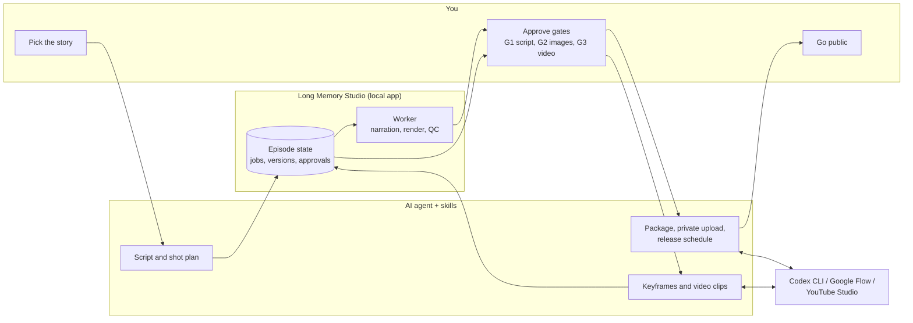
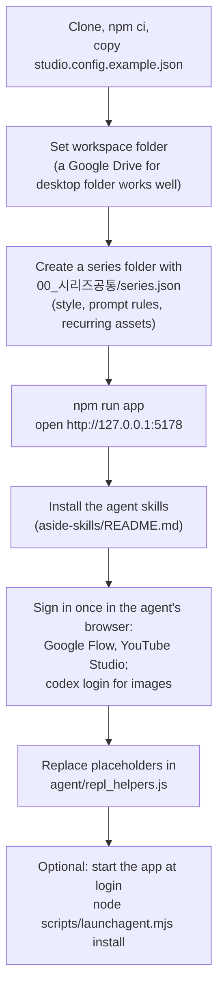
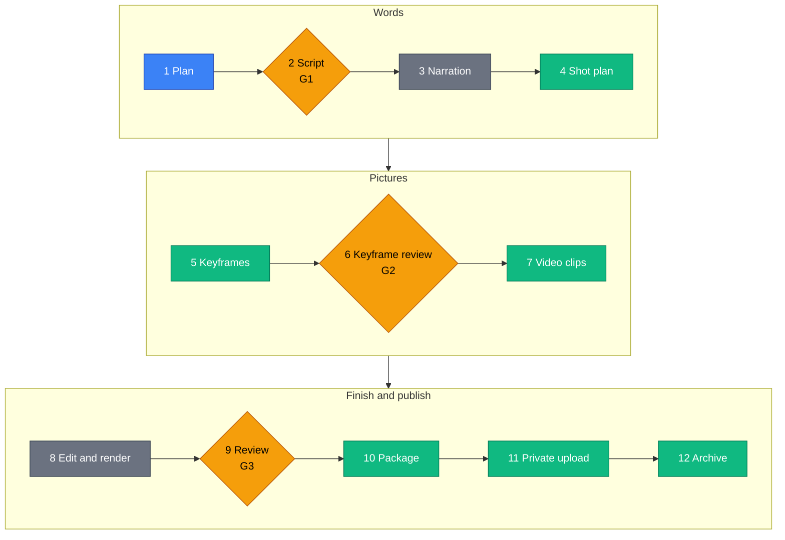
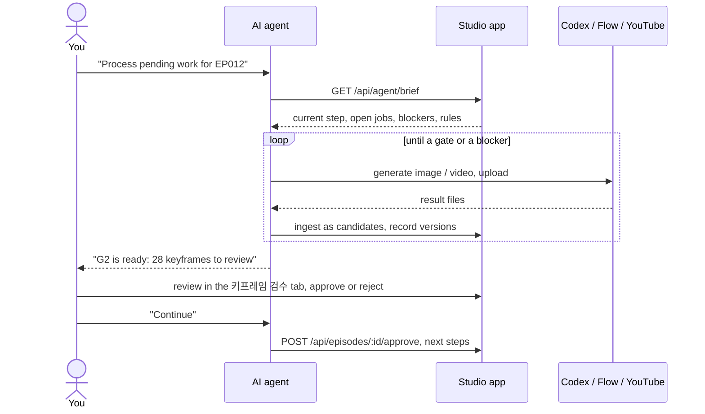
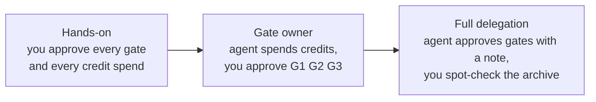
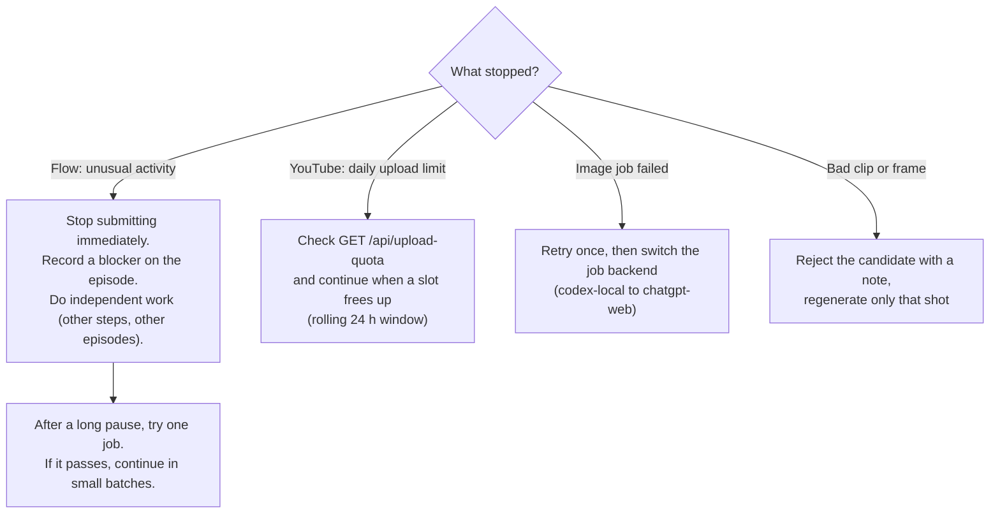
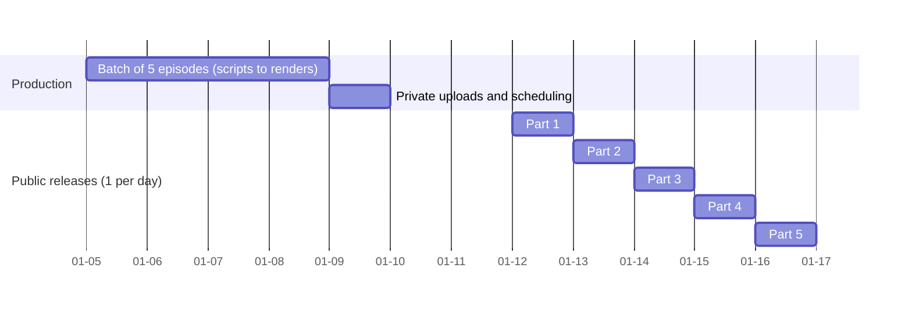

# Long Memory Studio

A local production studio for narrated long-form AI documentaries (built for the YouTube series "The Bible in Order").
It keeps the state of every episode (script, narration, shot plan, keyframes, video clips, render, QC, package, upload, archive)
in a local web app, renders with [Remotion](https://www.remotion.dev/), and exposes an API designed for an AI agent operator.

Jump to [How to use it: your workflow](#how-to-use-it-your-workflow) for the day-to-day process.

Shared as-is from a personal project. Paths, prompts and the 12-step workflow reflect one channel's needs: expect to adapt them.

## Requirements
- macOS (narration uses the built-in `say` voices; `swift` is used for Google Drive cache eviction)
- Node.js 20+ and npm
- Optional, depending on the steps you use: Codex CLI (image generation and translation scripts), a Google Drive for desktop
  folder as the workspace, Google Flow / YouTube Studio accounts operated through a browser agent (`agent/` helpers)

## Quick start
```
npm ci
xattr -dr com.apple.quarantine node_modules      # only if macOS blocks bundled binaries
cp studio.config.example.json studio.config.json # set "workspace" to the folder that will hold your episodes
npm run app                                      # http://127.0.0.1:5178
```
Create a series folder under the workspace (see `series` in the config), then register episodes with
`node scripts/new-episode.mjs <ID> --series <sid> --ep <N> --title "<title>"`.
The browser helpers in `agent/repl_helpers.js` contain placeholders (`YOUR_FLOW_PROJECT_ID`, `YOUR_CHANNEL_ID`, `/Users/YOU`)
that must be replaced before use.

## How to use it: your workflow

Long Memory Studio is built for a **you + AI agent** setup. You make the creative calls and approve three gates;
an AI agent (in our case [Aside](https://asidehq.com) with the skills in `aside-skills/`) does the repetitive work;
the app keeps every result so nothing depends on one chat session.



### 1. One-time setup



The series file is where your look is defined once (art style, what may never appear in a frame, recurring
characters and places). Every image and video prompt is built from it, so spend time here before episode 1.

### 2. One episode, twelve steps

Each episode moves through the same twelve steps. The app checks each step by itself (files present, versions
adopted, approvals recorded) and shows where the episode stands on its home tab.



A rejected frame at G2 goes back to step 5 for that shot only; a problem found at G3 goes back to step 7 (new clip or
a different segment of the same clip) and only that part is re-rendered.

Blue: you. Amber: your approval gate. Green: the agent. Grey: the app's worker (no AI needed).

| Step | What happens | Where you look |
|-|-|-|
| 1 Plan | Choose the source or story for the episode | your notes |
| 2 Script (G1) | Agent drafts narration and scenes; over ~8 min (~1,150 words) it is split into parts instead of cut | 대본·내레이션 tab |
| 3 Narration | Worker reads the script with a macOS voice (`scripts/tts.mjs`) | episode home |
| 4 Shot plan | Agent turns scenes into shots: still image or video, prompt, camera | 샷 보드 tab |
| 5 Keyframes | Image jobs (`scripts/kf-jobs.mjs`, Codex CLI) produce candidates; nothing is used until adopted | 작업 큐 tab |
| 6 Review (G2) | You check every frame against the series rules; reject sends it back to step 5 | 키프레임 검수 tab |
| 7 Video | Agent submits Flow jobs one at a time, collects and ingests clips, you or the agent adopt the good ones | 작업 큐, 샷 보드 |
| 8 Edit | Manifest, music cues and the Remotion render are produced by scripts | episode home |
| 9 Review (G3) | You watch the full render; technical QC (loudness, black frames, resolution) runs automatically | 렌더 검수 tab |
| 10 Package | Title, description, chapters, tags, translated subtitles, thumbnail | 패키지·업로드 tab |
| 11 Upload | Private upload, captions, scheduled release | 패키지·업로드 tab |
| 12 Archive | 360p proxy and stills kept, heavy local cache cleared | 보관 tab |

### 3. A normal working session

You do not drive the steps one by one. You start the agent, it reads the app's brief, does everything it is
allowed to do, and stops where your decision is needed.



Good habits:
- **One episode per agent session.** Start a fresh session for the next episode; the app and the skill carry
  everything over, the chat history does not need to.
- **Talk in outcomes, not commands.** "Make EP013 up to G2", "Upload the finished parts and schedule them",
  "What is blocked?" are enough.
- **Review in the app, not in chat.** Review sheets and the gate tabs show every candidate side by side with its
  prompt and history.

### 4. What you check at each gate

| Gate | You check | Typical fixes |
|-|-|-|
| G1 Script | facts and sources, tone, pacing, part split | ask the agent to rewrite a scene, never to shorten the whole script |
| G2 Keyframes | series rules (style, forbidden content, no text in images), continuity of recurring assets | reject with a note: the agent regenerates only that frame |
| G3 Render | watch end to end, music levels, clip artefacts, subtitles timing | swap a clip segment, re-render one part |

### 5. Decide how much to delegate



Whatever level you choose, keep these with a person: payments, switching a video to public, and anything that
would look like engagement manipulation. The app records who approved each gate
(`{"by": "user" | "aside", "note": ...}`), so a delegated decision can always be traced.

### 6. When something stops the line



Never try to bypass a platform's automation checks; pacing and the blocker record are there so the agent waits
instead of retrying.

### 7. Release rhythm

Production is bursty, publishing should not be. Finished episodes are uploaded as private videos (at most 10 per
rolling 24 h on our account) and scheduled one per day in episode order.



## Agent skills
`aside-skills/` contains the three Aside agent skills that operate this app (orchestrator, Google Flow video, images), with personal values replaced by placeholders. See `aside-skills/README.md` for the structure and how to install them.

## Notes
- Remotion has its own license: free for individuals and small companies, a company license is required otherwise
  (see https://www.remotion.dev/license). This repository's MIT license covers only the code written here.
- Google Flow and YouTube Studio have no public API for these steps; the helpers drive their web UIs. Follow each service's
  terms of use, keep human-like pacing and never try to bypass automation checks.
- AI-generated media should be labelled as such when published.

## License
MIT, see LICENSE.

## Technical notes

## Layout
- Code lives here (git). Media and episode data live in the **WORKSPACE** = Google Drive streaming folder
  (`studio.config.json` → `workspace`). Nothing media-heavy is committed.
- Episode folder (in WORKSPACE): `episode.json`, `thumbnail.json`, `_app/`, `1_발행본/`, `2_소스/`, `3_폐기_이전본/`, `4_프로젝트백업/`.
- `2_소스/` is the Remotion public dir: `keyframes/*.jpg`, `clips/*.mp4`, `narration/*.wav`, `bgm/*.wav`, `thumb/`.
  History lives under `keyframes/png`, `keyframes/end`, `keyframes/fix_*`, `clips/_raw`.

## Commands
```
node scripts/tts.mjs <ID> [--force]          # macOS say → 2_소스/narration
node scripts/build-manifest.mjs <ID>         # episode.json + WAV lengths → src/episodes/<ID>.manifest.json
node scripts/render.mjs <ID> preview|final|thumb [--publish]
                                             # default out/<ID>/; --publish writes to 1_발행본 and archives the old file
```
Register a new episode in `studio.config.json` → `episodes`, then add it to `src/episodes/registry.ts`.

## App
```
npm run app                                  # build UI + start http://127.0.0.1:5178 (server = worker)
node scripts/launchagent.mjs install         # optional: start the server at login (macOS LaunchAgent)
```
Tabs: 대장 · 에피소드 홈 · 시리즈 · 대본·내레이션 · 샷 보드 · 키프레임 검수 (G2) · 작업 큐 · 렌더 검수 (G3) · 패키지·업로드 · 보관

| Area | Data | Notes |
|-|-|-|
| Stage engine | computed | 12 steps with completion checks (`GET /api/episodes/:id/stages`), gates G1-G3 |
| Series | `<series>/00_시리즈공통/series.json` | style, rules (prompt fragments), assets (character/location/prop, scope, lock, episode tags `usedIn`, free `tags`, reference versions) |
| Shots | `episode.json` + `_app/production.json` | versions (keyframes/clips: adopted, candidate, superseded, rejected), prompts, defects, notes, kfReview, aiReview |
| Jobs | `_app/jobs/*.json` | frozen input snapshot, backend (`codex-local` default, `chatgpt-web`, `flow-web`, `aside-vision`), approval gate for credits, failure categories, credit ledger; results validated before becoming candidates |
| Review | `_app/review.json`, `_app/qc/` | issues with captures, QC results |
| Package | `_app/metadata.json`, `thumbnail.json`, `1_발행본/` | chapters auto from the manifest, tag budget, translations/subtitle checks, thumbnail render (`render.mjs thumb --publish` → JPG) |
| Upload | `production.upload`, `production.youtube` | checklist incl. "en SRT 게시됨", "auto captions deleted", watch-page verify |
| Archive | `_app/preview/` (480px stills, `proxy_360p.mp4`), `_app/archive.json` | Drive online-only status per folder; `swift scripts/evict.swift <paths>` clears the local Drive cache (files stay in Drive). Compiled Swift binaries get killed on this Mac, so run it with the `swift` interpreter |

Scripts: `codex-image.mjs <job>` (Codex CLI image), `qc.mjs`, `previews.mjs`, `proxy.mjs`, `new-episode.mjs`, `render.mjs`, `tts.mjs`, `build-manifest.mjs`, `migrate/*` (EP001 one-offs).
UI themes: `astryx-dark.css` (default), `astryx.css`, `original-dark.css` (M1 board only) in `app/web/src/themes/`; switch with `appTheme` in studio.config.json.
Aside skills (account): `longform-studio`, `longform-gpt-images`, `longform-flow-veo`.

## Flow clips and uploads (2026-11-11 mid-review, user-approved)
```
node scripts/mkveo.mjs <ID> [shots]          # approved flow-veo jobs (Omni 1.2 Flash 720p, 8 s); default anti-swirl wording
node scripts/flow-ingest.mjs <job> <1080p> <720p> [--edit <flowEditId>] [--no-complete]
                                             # Downloads → 2_소스/clips/_raw/<shot>_vN*.mp4, 1920x1080 check,
                                             # 5 review frames in _app/preview/clipcheck/, completes the job (job.flow.editId)
```
Browser side (Aside REPL helpers, account skill `longform-studio/scripts/repl_helpers.js`): `collectShot(job)` finds a
Flow tile by the START frame name under it and downloads 720p + 1080p; `clipSheet(ep, shots)` builds review sheets.
YouTube: at most **10 uploads per day**; auto English captions are deleted once at upload and left alone if YouTube
re-creates them (manual English must be published in the video-language row). Keep your own upload checklist next to the workspace.
Work one episode per fresh agent context (`clear` or a new task): all state is in the app, the skill and the helpers file.

## App API additions (2026-11-11)
| Endpoint | Purpose |
|-|-|
| `POST /api/episodes/:id/approve {gate, by:"aside"|"user", note}` | gate approvals keep who decided (`aside` + `delegatedBy:"user"` under the standing delegation) |
| `GET /api/upload-quota` | YouTube uploads in the last 24 h vs `uploadDailyLimit` (default 10), next free time |
| `PATCH /api/episodes/:id/blocker {reason, until} / {clear:true}` | external wait shown on the episode home and the ledger |
| `PATCH /api/queue/:job {prompt, durationSec?}` | edit a job before submission, previous prompts kept in `input.promptHistory` |
| `POST /api/episodes/:id/archive/done {by}` | step 12 is done by Aside after proxy, index and evict |
Ledger rows carry `epLabel` (EP010-2), `scheduledPublish` and `blocked`; `/api/episodes` returns `stageLabel` from the 12-step engine.

## AI-native layer (2026-11-11)
The app is operated mainly by an AI agent (Aside). Entry points: `GET /api/agent/brief` (markdown: `docs/agent-rules.md` + live state),
`GET /api/next` (all episodes: step, owner, blocker, how-to; proposes the next `upcoming` episode from studio.config.json),
`GET /api/flow/plan` (Google Flow submit/collect lists, 75 s pacing, block state; `POST /api/queue/:job/submitted`, `POST /api/flow/block`),
`GET /api/episodes/:id/summary` (compact), `GET /api` (route index). Browser helpers for the agent live in `agent/repl_helpers.js`
(served at `/api/agent/helpers.js`), the review-sheet image server in `agent/lms_static.mjs`. Runtime pacing state: `state/flow.json` (git-ignored).
The ledger shows the same next-action list to the user.

## macOS note (Aside)
Files written by Aside get `com.apple.quarantine`, and Gatekeeper kills unsigned binaries (esbuild, chrome-headless-shell).
After `npm ci` run: `xattr -dr com.apple.quarantine node_modules`.

## Fresh clone
`npm ci` → `node scripts/build-manifest.mjs <ID>` for each registered episode (manifests are generated, not committed) → render.

## M0 result (2026-11-04)
EP001 rendered from Aside with sources read directly from the Drive streaming folder: 8,236 frames / 274.5s in 293.8s,
**byte-identical (md5) to the previously published `1_발행본/BIB-GEN-001_final.mp4`**, SRT identical (66 cues).
