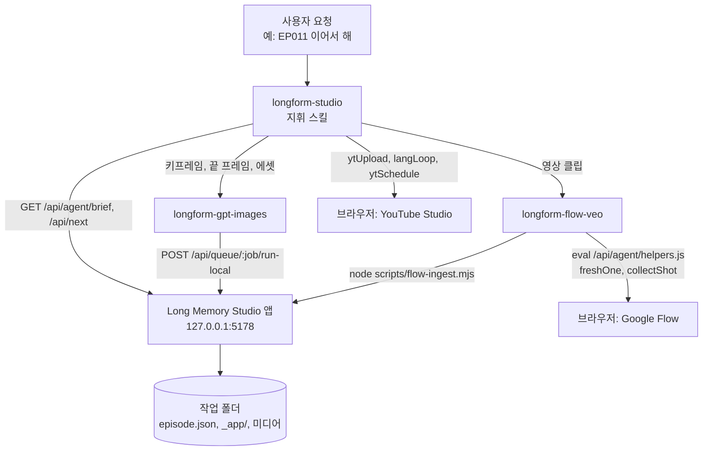

# Aside 스킬 (예시)

[English](README.md) | **한국어**

Long Memory Studio를 매일 운영하는 [Aside](https://asidehq.com) 에이전트 스킬 4개를 실제 사례로 공유합니다.
실제 쓰는 설정을 복사하고 개인 정보는 자리 표시자(`<repo>`, `<workspace>`, `<google-account>`, `<YOUR_CHANNEL_ID>`,
`<YOUR_FLOW_PROJECT_ID>` 등)로 바꿨습니다. 채널이 내린 결정과 겪은 문제 기록(날짜, 관찰한 한도, 실패한 일)도 남겨 두었으니
작동 예시로 읽고 자기 프로젝트에 맞게 규칙을 다시 쓰세요. 스킬 본문은 한국어로 쓰여 있습니다.

## 구조

```
aside-skills/
├── longform-studio/        전체 지휘: 작업 흐름, 게이트, 앱 API, 업로드/보관, 공개 일정, 결정 기록
│   └── SKILL.md
├── longform-flow-veo/      Google Flow 영상 작업: 모델 방침, 제출, 수집, 업스케일, 차단 대응
│   └── SKILL.md
├── longform-gpt-images/    키프레임 / 끝 프레임 / 에셋 이미지 (기본 Codex CLI, 대체 ChatGPT 웹)
│   └── SKILL.md
└── youtube-comment-care/   직접 실행: 새 댓글에 좋아요·하트·영어 답글 (따뜻한 목사님 말투)
    └── SKILL.md
```

각 부분이 연결되는 방식:



- **스킬은 지시, 앱은 상태.** 스킬은 에이전트가 무엇을 하고 어떤 규칙을 따를지 알려 주고, 모든 결과(작업, 승인, 클립, 업로드, 막힘)는
  앱에 기록됩니다. 그래서 새 에이전트 세션도 이전 대화 없이 `GET /api/agent/brief`에서 이어 갈 수 있습니다.
- **브라우저 헬퍼는 저장소에 있습니다**(`agent/repl_helpers.js`, `/api/agent/helpers.js`로 제공). 원본을 한 곳에 두기 위해서입니다.
  원래 설정에서는 `longform-studio/scripts/`에 대체용 사본을 두었습니다.
- **결정 기록은 지휘 스킬이 맡습니다.** 사용자가 정한 규칙(승인 위임, 업로드 한도, 자막 방침, "대본은 줄이지 않는다", Flow 제출 간격)은
  `longform-studio/SKILL.md`에 기록하고, 앱이 브리프에 함께 내보내는 `docs/agent-rules.md`에도 반복해 둡니다.

## Aside에 설치하기

스킬 폴더를 `~/.aside/u/0/skills/user/<skill-name>/`에 복사하고(폴더 이름은 SKILL.md 머리말의 `name:`과 같아야 함) 자리 표시자를 바꿉니다.
Aside는 사용자 스킬을 `description`으로 에이전트에게 보여 주므로, 이 줄에 언제 읽어야 하는 스킬인지 구체적으로 적으세요.

## 최소 양식

```markdown
---
name: "my-video-studio"
description: "언제 이 스킬을 읽어야 하는지 (에이전트가 요청과 대조할 수 있는 한 문장)."
---

# 내 영상 스튜디오

답변 언어, 말투, 절대 규칙 (사용자 승인이 필요한 일, 절대 자동화하지 않는 일).

## 시작
GET http://127.0.0.1:5178/api/agent/brief, 그다음 브라우저 헬퍼 불러오기.

## 작업 흐름과 게이트
단계, 단계별 담당, 승인 게이트.

## 절차
반복 작업마다 한 섹션 (렌더, 패키지, 업로드, 보관), 정확한 명령 포함.

## 결정 기록
날짜가 붙은 사용자 결정과 관찰한 플랫폼 한도, 최신순.
```
